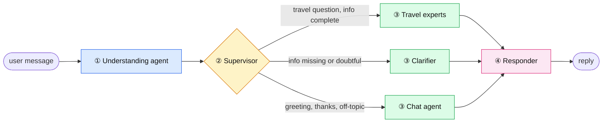
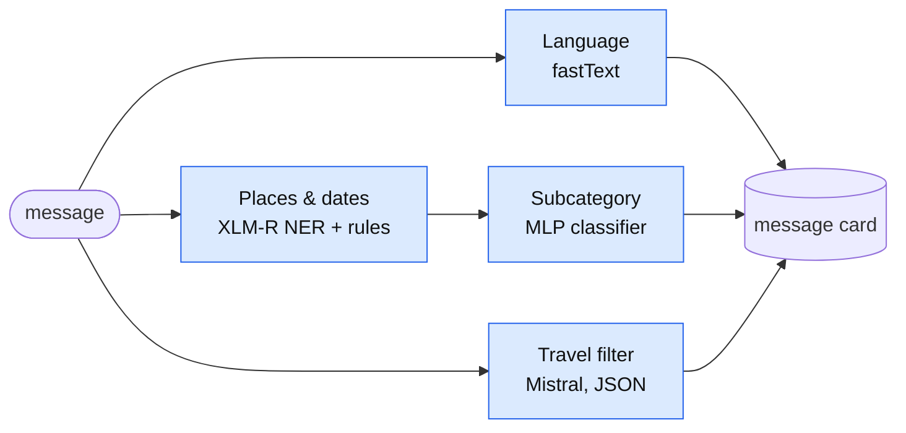
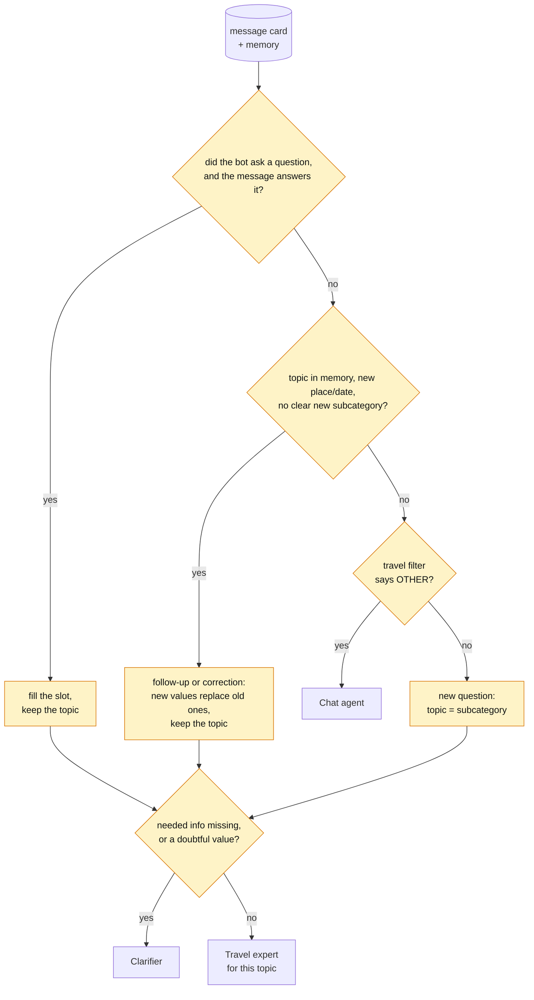
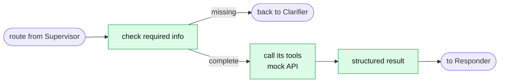
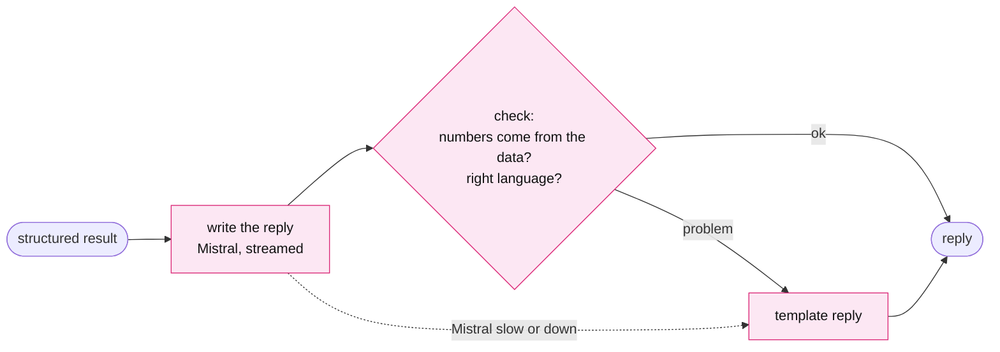

# Agentic architecture of the travel chatbot (LangGraph)

> Status: **v2, approved**, being built (v2.1: the travel filter stays as in Module 2; the Chat agent lets Mistral write; the Supervisor handles follow-ups with memory rules).
> LangGraph concepts used here are explained in [`langgraph_guide.md`](langgraph_guide.md).
> Diagrams are in Mermaid: they render on GitHub, or in VS Code with the "Markdown Preview Mermaid Support" extension.

---

## 1. The big picture: one message goes through 4 stages

```
                              ┌───────────────────────────────┐
                              │      CONVERSATION MEMORY      │   (remembers the conversation
                              │  language, topic, slots, ...  │    between messages)
                              └───────────────┬───────────────┘
                                              │ read / write
 user ──►  ① UNDERSTAND  ──►  ② DECIDE  ──►  ③ ACT  ──►  ④ ANSWER  ──►  user
           "what did the      "what should   "do the     "say it in the
            user say?"         I do?"          work"      user's language"
```

| Stage | Agent | One-sentence job |
|---|---|---|
| ① UNDERSTAND | **Understanding agent** | Turns the raw message into a clear "message card" (language, intent, places, dates...) |
| ② DECIDE | **Supervisor** | Reads the card + the memory and picks **one** route |
| ③ ACT | **5 travel experts**, or the **Clarifier**, or the **Chat agent** | Does the work for that route |
| ④ ANSWER | **Responder** | Writes the final reply in the user's language, checks it, never fails |



That's the whole system: **6 kinds of agent, 4 stages, 3 routes.**

---

## 2. Stage ① — the Understanding agent

**Job:** read the message once, with all our models, and produce a **message card**.



The three branches run **at the same time** (in parallel), so the slow one (Mistral, ~1.5 s) hides the fast ones (~60 ms).

| Part | Uses (already built) | Gives |
|---|---|---|
| Language | `detect_language()` — Module 1 | `en` / `fr` / `tn_latin` + confidence |
| Places & dates | `extract_entities()` + `extract_slots()` — Module 4 | Djerba (destination), 2026-11-27, 2 people, 300 TND... |
| Subcategory | `classify()` — Module 3 | `flight_price` + confidence + 2nd choice |
| Travel filter | `classify_travel()` — Module 2, **unchanged** (Mistral, JSON, 93.4% on val) | travel or other |

The filter looks at the message **alone**. Short messages that continue the conversation ("ghodwa", "w f sousse?")
are recognised by the Supervisor with the memory (section 3), not by the filter.

**The message card (example):**
```
text:        "9adech el billet men tunis l jarba nhar el jem3a?"
language:    tn_latin (100%)
travel:      yes
subcategory: flight_price (96%)
places:      Tunis (origin), Djerba (destination)
dates:       2026-11-27
```

---

## 3. Stage ② — the Supervisor (the orchestrator)

**Job:** look at the card and the memory, and choose **one route**. It decides with **simple rules, memory first**; only if the rules can't decide, it asks Mistral (structured JSON answer).



The two **memory rules** come first, because short messages that continue the conversation make no sense alone
(the travel filter could even call them "other"):
- **answer to our question** — the bot asked "when?", the user says "ghodwa" → fill the date and continue;
- **follow-up** — "w f sousse?" (and in Sousse?) → same topic as before, only the city changes;
- **correction** — "la, ba3d ghodwa" (no, the day after tomorrow) → the new date replaces the old one, redo.
  A follow-up and a correction are the same operation: **new values overwrite the old slots**.

If the rules are not sure (e.g. the classifier hesitates between two subcategories), the Supervisor asks Mistral to decide (added last, step 6 of the build).

---

## 4. Stage ③ — the agents that do the work

### 4a. The 5 Travel experts (one per category)

Each expert is a **small sub-graph** with the same 3 steps:



| Expert | Handles (subcategories) | Required info | Tools (mock API) |
|---|---|---|---|
| ✈️ **Flights** | flight_search, flight_price, baggage | destination (+ origin, date) | `search_flights()`, baggage rules from flights.csv |
| 🏨 **Hotels** | hotel_search, hotel_price, hotel_facilities | city (+ dates, nights, budget) | `search_hotels()` |
| 🌍 **Destination** | weather, activities, visa_documents | city / country (+ date) | `get_weather()`, info files* |
| 💰 **Money** | exchange_rate, trip_cost, payment_methods | currencies + amount / city | `get_exchange_rate()`, trip-cost estimate, info files* |
| 🚕 **Local transport** | car_rental, transfer_taxi, public_transport | city (+ dates) | info files* |

\* *info files = small data files for visa, activities, payment, transport, car rental, taxi — decision pending.*

### 4b. The Clarifier

**Job:** ask **one** short question for what is missing or doubtful, in the user's language, then **pause** the conversation until the user answers (LangGraph `interrupt`). The answer goes back through ① and ②, which fill the gap.

- missing: "Win t7eb tsafer?" / "Où voulez-vous aller ?" / "Where would you like to go?"
- doubtful: "Tqassed **Tunis**?" (the user wrote "touens")
- asks **at most 2 times** for the same thing; after that, answers with what it has.

### 4c. The Chat agent

**Job:** everything that is not a travel request. **Mistral writes a short reply** (streamed) in the user's language,
so it adapts by itself:
- greeting / thanks / goodbye → friendly reply + "how can I help with your trip?"
- off-topic → polite "I can only help with travel questions"
- frustration ("ma fhemtnich!") → apologise and offer to rephrase

If Mistral fails or is too slow: **one neutral template** per language that fits all cases
("I'm your travel assistant, how can I help with your trip?").

---

## 5. Stage ④ — the Responder

**Job:** turn the expert's structured result into a short, natural reply, **and never fail**.



- **Streamed:** the first words appear after ~0.5–1 s, even though the whole reply takes ~6–10 s on our GPU.
- **Check:** every price / time / temperature in the reply must exist in the expert's data, and fastText must agree the reply is in the user's language.
- **Fallback:** a template reply (in the 3 languages) if the check fails or Mistral is slow/down — the user always gets an answer.

---

## 6. Memory: what the bot remembers

Kept by LangGraph's **checkpointer**, one conversation per `thread_id`:

| Memory item | Example | Used for |
|---|---|---|
| conversation language | `tn_latin` | content-free messages like "paris ?" |
| current topic | `flight_price` | follow-ups ("w f sousse?") |
| collected info (slots) | destination = Djerba, date = 2026-11-27 | filling the gaps across messages |
| pending question | "waiting for: date" | understanding the user's next answer |
| last result | the 2 flights found | "fama ar5es?" (anything cheaper?) |
| message history | all messages | the Supervisor's LLM decision when unsure |

---

## 7. Four examples, step by step

**A. A clear question** — "9adech el billet men tunis l jarba nhar el jem3a?"
1. ① card: tn_latin · travel · flight_price · Tunis → Djerba · 2026-11-27
2. ② everything clear → **Flights expert**
3. ③ `search_flights(Tunis, Djerba, 2026-11-27)` → 2 flights
4. ④ "Fama zouz vols nhar el jem3a: ... b 150 DT."

**B. Missing information** — "nheb billet l paris"
1. ① card: flight_search · destination Paris · **no date**
2. ② info missing → **Clarifier** → "Wa9tech t7eb tsafer?" (pause)
3. user: "ghodwa" → ① card: date 2026-11-25 (no topic of its own)
4. ② memory rule: the bot was waiting for a date and got one → fill it; memory has Paris + date → **Flights expert** → ④ reply

**C. A follow-up** — after a weather answer for Djerba, the user writes "w f sousse?"
1. ① card: place Sousse · no clear subcategory
2. ② memory rule: topic = weather, new place → Sousse replaces Djerba → **Destination expert** → ④ reply

**D. Off-topic** — "a3tini recette mlou5iya"
1. ① card: not travel · no topic in memory to continue
2. ② → **Chat agent** → Mistral: "Samahni, najem n3awnek ken fel safar ..."

---

## 8. What is left out on purpose (possible later extensions)

To keep the design clear and fast on our hardware, these are **not** in the core:
- several questions in one message handled in parallel (for now the Supervisor asks "which one first?");
- a long-term user profile across conversations;
- an LLM that freely chains tools (ReAct agent) for open-ended trip planning;
- a second LLM as a "judge" of the reply.

Each can be added later as one extra node without changing the 4 stages.

---

## 9. LLM calls per message (the real cost on our GPU)

| Case | Mistral calls | What the user waits for |
|---|---|---|
| Clear travel question | 2 (travel filter, in parallel + reply, streamed) | ~1.5 s, then words start appearing |
| Unclear message | 3 (+ Supervisor decision) | ~3 s, then words appear |
| Greeting / thanks / off-topic | 2 (travel filter + Chat agent reply, streamed) | ~1.5 s, then words appear |
| Clarification question | 1 (travel filter only) | ~1.5 s, template question |
| Mistral down | 0 effective | template reply |

---

## 10. Build order

1. ✅ Travel data tools (`src/mock_api/service.py`) + info files.
2. ✅ The state + memory (`src/pipeline/state.py`), and the **Understanding agent** (`understanding.py`; travel filter prompt v3).
3. ✅ The **Supervisor** (`supervisor.py`), the **Chat agent** (`chat_agent.py`: Mistral, streamed, one fallback) and the **Clarifier** (`clarifier.py`: fixed questions, no `interrupt`).
4. ✅ The **5 Travel experts** (`experts.py`: one node each, sharing the same 4 steps — plain functions, not sub-graphs, since each is ~1 ms of Python) + the main graph (`graph.py`).
5. ✅ The **Responder** (`responder.py`: streamed; numbers check → replace by a data card; language check flagged only).
6. The Supervisor's LLM decision for unclear cases; follow-ups and corrections.
7. Scenario tests (the 4 examples above and more) + the graph drawn from the code for the report.
